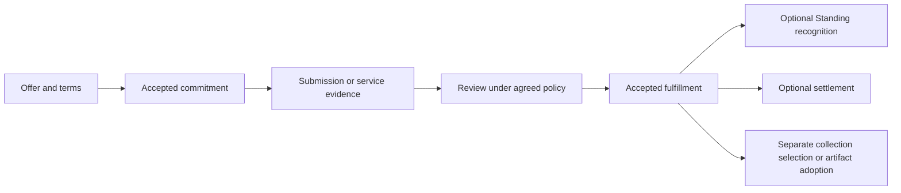

# Namespace services and bounties design brief (2026-11-01)

**Status:** design brief. The agreed direction separates roles and authority,
commitments and fulfillment, optional compensation, and the data those services
work on. Namespace bindings, bounty records and their integration below are
proposals, not implemented APIs or a new execution plan. This brief extends
the community collections continuation of the
[Moot object M1 plan](../../archive_docs/2026-11-01/2026-06-12_moot_object_m1_plan.md)
(archived 2026-11-01); its existing qualification limits remain. The first
namespace/agreed-work slice landed under S4 of the
[site extraction plan](../../2026-11-04_site_extraction_plan.md); the
[Moot publication plan](../implementation_strategy/2026-11-01_moot_publication_plan.md)
records it in its 2026-11-04 findings.

A Moot should be able to organize shared resources in a governed namespace and
invite people to contribute or maintain them. Different services can retain,
replicate, index, transform or publish selected parts. A filesystem is one view
of those resources. A curated directory of external websites, an archive, a
search index and a community-adopted model can inhabit the same community space
without sharing a storage format or backend.

A bounty describes requested work and its acceptance terms. It can be one-off or
standing, paid or pro bono. Performing a role's agreed duties can fulfill a
standing bounty. Holding the role alone does not establish fulfillment.

## Existing basis and limits

The following findings come from the Gemot checkout inspected on 2026-11-01,
before these documentation changes. They are source findings, not new runtime
qualification.

| Existing owner | What this brief builds on |
|---|---|
| [Gemot collections](../../../crates/gemot/src/moot/records/collection.rs) | Stable collection and contribution references, causal versions, selected membership and forks. A collection version is a useful exact input to work; a general namespace binding is still proposed. |
| [Gemot typed authorization](../../../crates/gemot/src/moot/typed_authorization.rs) | Constitutional grants and scoped delegation through the shared capability vocabulary. New service permissions must use this seam. |
| [Gemot hosting](../../../crates/gemot/src/moot/hosting.rs) | Signed, bounded promises naming content, audience, host/device, expiry, policy and observed authority. Current serving checks are distinct from the promise. |
| [Mien Standing](../../../crates/mien/src/event.rs) | Commitments, heartbeats, owner-asserted fulfillment and handoff. These facts do not by themselves prove that a bounty's acceptance criteria were met. Automatic hosting heartbeats/completion remain open. |
| [Mooting recognition](../../../crates/mooting/src/recognition.rs) and [Tulpa](../../../crates/gemot/src/moot/tulpa.rs) | Recognition over a frozen electorate and community adoption of exact artifact versions. Bounty acceptance can reuse the recognition mechanism without making every result a Tulpa. |
| [FLORA](../../../crates/gemot/src/moot/flora.rs) | Specific federated LoRA round contracts and artifact receipts. It does not execute training or represent arbitrary distillation. |
| [Moothold reciprocity](../../../crates/moothold/src/reciprocity.rs) | A directed service balance between Moots. This is not a general payment system or evidence that cross-Moot service requests and settlement are implemented. |

The earlier economy proposal is historical context:
`mere/design_docs/archive_docs/2026-10-06_retired_plans/2026-06-30_bounty_verification_economy_plan.md`.
Its bounty types were explicitly unbuilt. This brief carries forward explicit
acceptance and separate standing, while making compensation optional and allowing
work within a Moot as well as beyond it. Mandatory credits, escrow and a universal
verification market are not premises of this design.

## Governed namespace

A namespace binding associates a stable scope with a selected collection or
resource and the policy for changing that association. Names are convenient
addresses; collection, contribution and artifact identities carry the durable
references. Renaming a directory or recomputing a graph cluster must not silently
grant access to new content.

Illustrative names, not a URI scheme or proposed wire grammar:

```text
sites/catalog       references to relevant external sites and indexes
sites/captures      selected retained snapshots of those sites
indexes/topics     a derived search artifact over an exact selected version
public/site        a selected publication served to nonmembers
models/candidates  submitted adapters or distilled models awaiting adoption
```

An external reference does not imply a local copy. A capture records its source
and acquisition context. An index records the input versions and indexing
contract. An index of indexes can describe coverage and point to other indexes
without fetching their entire contents. Fetching, refreshing and retaining those
contents are additional requested services.

Bindings may expose overlapping collections through several names or views.
Authority belongs to the stable scope and accepted policy, not an accidental
directory prefix. Concurrent binding changes must use the owner's accepted
history and conflict rules; a backend's most recently observed value cannot
choose the authoritative version.

## Roles, grants and work

Roles describe community responsibilities. Actual operations require current
grants. One participant may perform several roles; a participant may also submit
one contribution without taking a continuing appointment.

| Role | Responsibility | Authority to keep separate |
|---|---|---|
| Steward or curator | Maintain namespace bindings and collection selection. | Selection does not transfer authorship or grant publication rights. |
| Contributor | Supply references, captures, indexes, models or other artifacts. | Submission does not authorize adoption or replacement of shared results. |
| Keeper | Retain agreed content and, when authorized, serve it. | Retention, plaintext access and public serving are separate powers. |
| Indexer or transformer | Read approved inputs and produce a derived artifact. | Reading inputs does not authorize exposing the result to a wider audience. |
| Publisher | Expose a selected revision to an approved audience. | Publication requires the content owner's permission and current community authority. |
| Reviewer or verifier | Assess fulfillment under the accepted terms. | Acceptance, artifact adoption, payment and appointment are separate decisions. |

The Moot's constitution governs appointments, grants and review policy. Clients
present these facts and submit authorized intentions; running a client grants no
role. An indexer may work voluntarily, under recurring compensation, or for a
single bounty with the same scoped technical permissions.

## Backends and derived views

Attach services by purpose: a storage backend retains verified content; a
replication service moves it; an indexer builds a derived view; a publisher serves
an approved projection. One implementation may perform several functions, but
each has explicit scope, audience, limits and evidence. A search backend need not
be a storage backend, and storing encrypted bytes need not grant indexing access.

Keep the existing content and transport seams as the starting point. The Mere
protocol plan describes p2panda with iroh-blobs for byte transfer
(`mere/design_docs/mere_docs/implementation_strategy/2026-10-28_moot_protocols_plan.md`).
IPFS is a candidate additional distribution and publishing adapter. Its
[content identifiers](https://docs.ipfs.tech/concepts/content-addressing/) depend
on representation and import settings; a CID is not interchangeable with an
existing raw content digest. An adapter must bind and verify both identities.

Deduplicate identical stored representations where the content owner permits it,
while retaining separate contribution, capture and authorship records. Private
deduplication stays within the permitted custody/encryption domain; independent
encryption may produce different bytes. Cross-domain equality disclosure is not
an automatic optimization. Releasing one copy or withdrawing one contribution
cannot collect bytes still covered by another live retention claim. IPFS provides
[transport encryption, not default content secrecy](https://docs.ipfs.tech/concepts/privacy-and-encryption/),
and [pinning protects retained data from garbage collection](https://docs.ipfs.tech/concepts/persistence/);
neither substitutes for Gemot access policy or observed availability.

## Bounties and commitments

An offer may request a deliverable or an ongoing service. Acceptance of its terms
creates a commitment; an appointment can reference that commitment without
merging the two. A standing offer remains available or renews by policy, while
each participant's undertaking has explicit limits. The word *standing* here
means ongoing; **Standing** remains Mien's reputation mechanism.

The proposed agreement records:

- The requesting Moot, offer revision, contributor and relevant authority.
- The work and scope: exact input version, output destination, or an explicit
  rule for following updates. Service windows have identifiable boundaries.
- Acceptance criteria, eligible reviewers, required evidence and the applicable
  recognition policy. Terms identify whether self-attestation is sufficient.
- Resource ceilings, audience, duration, renewal, cancellation and handoff terms.
- Optional compensation: none, money, goods, service in kind, or a combination;
  named counterparties and discharge conditions, with no mandatory common unit.

Terms, evidence and source references have their own audience. A public receipt
must not implicitly publish private input locations or settlement details.

An ongoing hosting agreement might reference an existing bounded hosting promise.
A search bounty instead names coverage, freshness, provenance and an evaluation
method. An artifact hash establishes identity and integrity; it does not establish
that a search index is useful or a model is accurate.



Review can also request changes, reject a submission, or remain pending for
missing evidence. Acceptance binds the exact terms, submission or service window,
review evidence and authority context. Frozen review policy prevents later roster
changes from silently rewriting the agreement; current revocation still governs
new actions. Missing historical authority evidence remains pending, not proof of
authorization or misconduct.

Work acceptance, adoption and settlement retain separate states. A payment
failure does not erase accepted work; accepting a model does not deploy it.
Repeated delivery of the same receipt must not duplicate rewards or settlement.
External settlement adapters report their own evidence and uncertainty. Service
in kind is discharged according to its own agreed performance terms.

Volunteers use the same explicit scope and recognition process, with no payment
obligation. They may leave through the agreed cancellation or handoff process.
A successor must consent and receive current grants; a handoff record cannot
silently appoint or authorize them. Appointment, compensation and reputation
remain independent, so payment never purchases governance implicitly.

## Concrete uses

| Request | Deliverable or evidence | Compensation and adoption |
|---|---|---|
| Maintain a directory of relevant websites and existing indexes. | A curated reference collection with coverage, source notes and freshness observations. Retained captures are optional. | Pro bono is sufficient; a curator accepts the selected references. |
| Keep an archive available while its original author is offline. | Bounded hosting promise plus timed retrieval/integrity observations for the agreed service window. | Money or reciprocal hosting can be agreed. A heartbeat alone does not prove retrieval. |
| Build a topic index from an agreed collection. | Exact input version, index artifact, extraction/indexing contract and agreed relevance checks. | One-off reward or ongoing maintenance terms; search consumers select the accepted version. |
| Gather data and offer distilled weights to the Moot. | Authorized source references, recipe, base-model identity where applicable, exact output and evaluation evidence. | Review can recognize the contribution; Tulpa adoption is separate. Use FLORA only for work that actually follows its federated LoRA contract. |

## Ownership and open design choices

Gemot should own community namespace bindings, offer/agreement facts and acceptance
authority, composing existing collections and governance. Mien retains Standing;
Mooting evaluates recognition policy; Tulpa records community artifact adoption.
Keep these domain facts out of storage plugins. This assigns responsibilities,
not new crate names or a decision to add an eighth replication lane.

Eidetic owns content identities, manifests, custody and derived-artifact storage;
Muniment supplies persistence. Commons keeps shared graph operations. Stickleback
and the existing transport owners handle accepted-operation replication and byte
transfer. Domain applications execute indexing or training; Distillery/ESP owns
tensor work and Mesh owns compute jobs/leases where used. Resident/application
hosts compose services and publication adapters. Moothold reciprocity applies
when participating Moots explicitly agree to reciprocal service.

An index is itself governed content. Revoked inputs must leave the current search
projection or make it explicitly stale until rebuilt; old index artifacts cannot
remain a current authorized query path by accident. Derived models need an
explicit release decision because weights can disclose training information.
Withdrawal or revoked keys cannot erase copies already received.

The remaining choices are narrow enough to resolve against a first consumer:

- The namespace binding grammar and whether the initial surface needs aliases
  over collections, hierarchical mounts, or both. A full POSIX filesystem is not
  required for the collection and service model.
- The owner commands and compatible encoding for offers, accepted agreements and
  review decisions. Reuse the signed-operation pattern without reinterpreting
  existing Standing events as independently verified fulfillment.
- How recognized fulfillment may affect Standing. Existing owner-issued
  `CommitmentFulfilled` semantics stay explicit; an acceptance-to-Standing bridge
  requires a deliberate rule, including voluntary work and handoff.
- The concrete service evidence and settlement adapter needed by the first
  agreement. No universal pricing, escrow or proof system is required up front.

A useful design check is one small collection with a volunteer keeper and a
separately accepted index contribution: names resolve to exact versions, grants
bound each service, actual retrieval is distinguishable from a promise, and
acceptance works without payment. This is an illustrative validation target,
not an implementation commitment. Protected serving, cross-machine availability,
historical authority replay and settlement would each need their own evidence.

## Implementation map (2026-11-04)

**Status:** proposed implementation sequence; no feature phase has started in
this work. This records the implementation breakdown accompanying the brief,
with the source findings below rechecked on 2026-11-04. The initial target is
named collections with unpaid contribution/review, followed by standing volunteer
hosting and then additional backends, protected collections and settlement.

### Work and owners

| Work | Owner and existing basis | Required extension |
|---|---|---|
| Governed names | Gemot [collections](../../../crates/gemot/src/moot/records/collection.rs) and typed authorization. | Signed bindings from names to stable collection/resource identities, exact-version or explicit update-following rules, concurrent-change handling, rename/removal and scoped commands. Permissions follow stable identities. A filesystem mount can consume this later. |
| Agreements and roles | Gemot [aggregate](../../../crates/gemot/src/moot/service.rs) and signed domain/store pattern. | Offers, accepted terms, submissions, review decisions, cancellation, renewal and consensual handoff; appointments reference grants and commitments. Add deterministic folds, durable commands, snapshots, replication, export/import and retention support. Choose an existing records lane or a distinct lane explicitly. |
| Recognition | [Mooting](../../../crates/mooting/src/recognition.rs), [Mien](../../../crates/mien/src/event.rs) and Gemot acceptance authority. | Bind review to exact terms, evidence and electorate; make replay idempotent. Define any effect on Standing separately from work acceptance, artifact adoption and settlement. Require successor consent and current grants for handoff. |
| Service execution | Resident/application hosts composing [Gemot hosting](../../../crates/gemot/src/moot/hosting.rs), Eidetic retention and existing transport/fetch adapters. | Discover accepted obligations, acquire approved inputs, retain or process them, serve approved outputs and record observations. Recover across restart and uncertain completion; react to expiry, withdrawal, changed grants and device ceilings. |
| Deduplicated retention | Eidetic content/retention over Muniment storage. | Separate physical bytes from owner retention claims, permission and quota accounting. Make acquisition, claim creation/release and collection of unused bytes crash-safe. Preserve bytes while any live claim requires them. Start with whole-object reuse within a permitted encryption domain. |
| Search and derived artifacts | Eidetic search and domain applications; Tulpa for model adoption; FLORA only for its specific federated LoRA contract. | Start with curated references/captures, provenance, coverage/freshness and a local indexing recipe. Shared prebuilt or remotely queried indexes need format, audience and freshness contracts. Training execution and evaluation remain with their domain owners. |
| Client workflow and compensation | Existing Moot/Graphshell consumers and host adapters. | Show offers, commitments, evidence and review; distinguish promised, retained, observed available, accepted and settled. Record optional compensation from the first agreement. Add execution adapters for money or reciprocal service when needed; payment failure preserves accepted work. |

### Findings (2026-11-04)

- Gemot's existing aggregate exposes collection commands, snapshots, outbound
  operations and native-drop import/export. New facts must participate in those
  boundaries as well as their own fold; adding an enum alone is insufficient.
- Mien's [ledger](../../../crates/mien/src/ledger.rs) currently closes a commitment
  and awards its configured recognition on owner-issued `CommitmentFulfilled`.
  Bounty acceptance needs its own evidence and authority. Existing semantics
  must not silently become a claim of independently verified work.
- `eidetic/crates/eidetic-search/src/lib.rs` specifies community exchange of
  admitted capture records and local `DocumentIndex` rebuilding.
  `mere/ports/moot/src/captured_web.rs` already consumes that seam. For the initial
  indexing bounty, deliver the admitted corpus and recipe; portable prebuilt
  indexes remain a further contract.
- `eidetic/crates/muniment/src/blob.rs` already stores immutable blobs by content
  hash. `eidetic/crates/eidetic-core/src/retention.rs` currently keys retained
  bodies by owner and manifest. Physical reuse across those retained copies
  therefore requires explicit claim/accounting integration.
- `mere/crates/system/fetch/src/iroh_blob.rs` already acquires content through a
  host's existing Iroh transport. `mere/ports/moot/src/resource_coop/handlers.rs`
  supplies retention/hosting dispatch and serving. The new work connects these
  seams to durable service agreements and observations.

### Proposed phases and done-conditions

**N1 — named collections and unpaid contributions.** Implement bindings and the
offer/agreement/submission/review domain, with optional compensation terms and an
explicit unpaid path. Expose the workflow in an existing consumer. Resolve the
binding grammar, event encoding/lane placement and review policy before wiring
the signed commands; keep recognition effects explicit.

Done when independent replicas converge on bindings and accepted work after
reordered/duplicate delivery and durable reopen; export/import reconstructs the
new facts; stale or unauthorized updates refuse; renaming cannot broaden access;
and a reviewed website-reference collection can be searched through locally
derived permitted records. Acceptance must work with no payment obligation.

**N2 — standing volunteer hosting and observed retrieval.** Add bounded service
windows, renewal/cancellation/handoff, the durable host lifecycle and observations
linked to the agreed content and interval. Integrate retention claims wherever
physical bytes are shared. Retries recover committed state without duplicating
obligations or recognition.

Done when a contributor supplies a small public collection, a different keeper
acquires and retains it, the contributor stops, the keeper restarts, and a fresh
reader retrieves the exact material. Include a separately accepted indexing
contribution. Exercise expiry, withdrawal, revoked grants, corrupt bytes,
interrupted acquisition and successor consent. Releasing one retention claim
must preserve bytes covered by another. A heartbeat remains distinguishable
from successful retrieval. Record separate-process and two-machine evidence
separately; the former does not close the latter gate.

**N3 — additional backends, protected scopes and compensation.** Extend the same
contracts with the next concrete acquisition/publication backend, protected
collection lifecycle, and a required settlement adapter. IPFS, an OS filesystem
mount, remote index querying and model-training workflows remain separable
consumers. Each requires its own scope and acceptance evidence.

Done per extension when existing authority and content identity survive backend
changes; protected scopes recheck grants and key epochs, including after restart;
withdrawal removes inputs from current searchable projections; and duplicate or
uncertain settlement cannot create duplicate obligations or erase accepted work.
Model adoption remains separate from training acceptance and deployment. Complete
historical-authority replay and cross-machine availability keep explicit gates.

### Progress

- **2026-11-04:** Recorded the implementation map and proposed completion checks.
  Source inspection and documentation checks only; no new runtime qualification.
